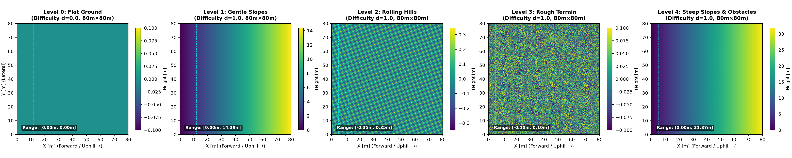

# Adaptive Humanoid Locomotion with Temporal Context and Procedural Terrain Curriculum

> **Robot:** Unitree G1 (23-DOF Humanoid) · **Simulation:** MuJoCo Playground / MJX (JAX)  
> **RL Algorithm:** PPO with Causal Temporal Context · **Compute:** Dual NVIDIA Tesla T4 (Kaggle) / AWS A10G

---

## 1. Environment Description

This project trains a **Unitree G1 humanoid robot** to achieve stable, adaptive planar locomotion across diverse, challenging terrains and changing contact dynamics.

### Robot & Actuation Specification
- **Robot:** Unitree G1 humanoid robot ($\approx 35\text{ kg}$, $1.3\text{ m}$ height).
- **Degrees of Freedom:** 23 actuated revolute joints across legs, waist, and arms.
- **Simulation Frequency:** $500\text{ Hz}$ physics simulation timestep ($dt = 0.002\text{ s}$).
- **Policy Control Rate:** $50\text{ Hz}$ policy execution rate ($\Delta t = 0.02\text{ s}$).

### POMDP Formulation & Observation Contract
In real-world deployment, physical parameters such as ground friction $\mu$, contact geometry, and mass distribution are **latent** (not directly observable). We formulate humanoid locomotion as a Partially Observable Markov Decision Process (POMDP):

- **Proprioceptive Observation Vector ($o_t \in \mathbb{R}^{58}$):**
  - Base angular velocity ($\omega_x, \omega_y, \omega_z \in \mathbb{R}^3$)
  - Projected gravity vector ($g \in \mathbb{R}^3$)
  - Target velocity commands ($v_x^{\text{cmd}}, v_y^{\text{cmd}}, \omega_z^{\text{cmd}} \in \mathbb{R}^3$)
  - Joint positions ($q_t - q_{\text{default}} \in \mathbb{R}^{23}$)
  - Joint velocities ($\dot{q}_t \in \mathbb{R}^{23}$)
- **Action Space ($a_t \in \mathbb{R}^{23}$):**
  - Continuous PD target joint position offsets added to default nominal standing pose.

### Evaluated Model Architectures (M1–M4)
| Model ID | Policy Input | Architecture | Scientific Role |
|:---:|:---|:---|:---|
| **M1** | Current observation $o_t$ | Standard MLP | Baseline without temporal context |
| **M2** | Current observation $o_t$ | Capacity-Matched MLP | Control for parameter count |
| **M3** | $[o_t, h_t]$ where $h_t = \{(o_{t-k}, a_{t-k}), \dots\}$ | PPO with History Stacking | Evaluates explicit short-term causal history |
| **M4** | $[o_t, z_t]$ where $z_t = f_\phi(h_t)$ | PPO with Learned History Encoder | Evaluates learned latent temporal representation |

---

## 2. Procedural Diverse Terrain & Depth Map Analysis

The training environment generates a reproducible singular heightfield arena ($80\text{ m} \times 80\text{ m}$, $8\text{ cm}$ horizontal cell resolution). Terrains are organized into 5 difficulty levels with **continuous difficulty scaling $d \in [0, 1]$**.

### Top-Down Depth Maps of All Singular Terrains at Maximum Difficulty ($d=1.0$)

Each environment instance is generated using **one singular terrain category** (with dimensions $80\text{ m} \times 80\text{ m}$, $8\text{ cm}$ resolution). The figure below shows the top-down elevation depth maps (in meters) for all five terrain categories generated at maximum difficulty ($d=1.0$):



### Terrain Category Specifications

| Level | Category | Generation Method | Max Difficulty ($d=1.0$) Characteristics | Training Heading Rule |
|:---:|:---|:---|:---|:---:|
| **Level 0** | **Flat Ground** | Constant elevation ($0.0\text{ m}$) | Strictly flat ground ($0.0\text{ m}$). Used for baseline nominal walking. | Omnidirectional |
| **Level 1** | **Gentle Slopes** | Linear elevation gradient | Slopes up to $10.2^\circ$ ($0.18$ gradient, elevation rise across $80\text{ m}$). | Uphill |
| **Level 2** | **Rolling Hills** | Multi-octave continuous harmonic waves / Gaussian hills | Undulating peaks and valleys with amplitude up to $0.40\text{ m}$ ($0.80\text{ m}$ peak-to-trough). | Omnidirectional |
| **Level 3** | **Rough Terrain** | High-frequency stepped random noise | Stepped terrain blocks with noise amplitude up to $\pm 0.10\text{ m}$ ($20\text{ cm}$ vertical variance). | Omnidirectional |
| **Level 4** | **Steep Slopes & Obstacles** | Procedural ramps, stairs, and stepping stone platforms | Steep ramps up to $19.3^\circ$ ($0.35$ gradient) and obstacle platforms up to $0.25\text{ m}$ height. | **Strictly Uphill** ($\vec{v} \cdot \hat{u} > 0$) |

---

## 3. Adaptive Sequential Curriculum with Continuous Prerequisite Health Check

The environment operates on **ONE singular terrain category for each rollout**, starting with strictly $0.0\%$ spawn probability on harder terrains and advancing sequentially:

```text
[Level 0: Flat] ──► [Level 1: Gentle Slopes] ──► [Level 2: Rolling Hills] ──► [Level 3: Rough Terrain] ──► [Level 4: Steep Slopes & Obstacles]
       ▲                      ▲                         ▲                         ▲                         ▲
       └──────────────────────┴─────────────────────────┴─────────────────────────┴─────────────────────────┘
                               All Preceding Stages Must Maintain ≥ 90% Success Rate
```

```text
PPO Training Rollouts (Singular Terrain per Environment)
        │
        ▼
Episode Performance Metrics (Tracked Per Category) ──► [Success Rate, Fall Rate, Distance]
        │
        ▼
Continuous Prerequisite Health Check
        │
        ├─► All Prerequisites Healthy (≥ 90%) & Frontier Mastered (d=1.0 with Patience):
        │     🎓 UNLOCK NEXT STAGE (e.g. flat ──► gentle_slopes ──► rolling_hills ...)
        │
        ├─► Normal Operation (Frontier Focus + Exponential Retention):
        │     Frontier gets 40–70% focus; unlocked earlier stages retain small anchors (≥ 5%)
        │
        └─► Prerequisite Health Failure (Any stage j < K drops < 90% for patience window):
              ⚠️  TARGETED INTERVENTION:
                  - 75% focus immediately shifts to the failing prerequisite
                  - 25% anchor remains on other unlocked stages (prevents forgetting them)
                  - Once restored (≥ 90% with confirmation patience) ──► Normal training resumes!
```

### Key Curriculum Rules:
1. **Zero Initial Spawn Rate for Higher Terrains:**
   - At step 0, Levels 1 through 4 have **strictly 0.0% spawn probability**.
   - A stage only unlocks when **all preceding prerequisite stages maintain $\ge 90\%$ success**.
2. **Continuous Prerequisite Health Check:**
   - The curriculum continuously monitors rolling success rates across all unlocked stages.
   - If an earlier skill degrades (e.g. slopes drop to $82\%$ while training on rolling hills), the policy does not continue blindly forward.
3. **Targeted Intervention (Anti-Catastrophic Forgetting):**
   - When a prerequisite drops below $90\%$, **$75\%$ of rollouts immediately shift to reinforce the failing prerequisite**.
   - Crucially, the remaining **$25\%$ is split among the other unlocked stages as retention anchors**—preventing the policy from forgetting higher skills during the recovery period.
4. **Patience Hysteresis (Eliminates Flickering):**
   - Configurable patience windows prevent high-frequency distribution oscillation:
     - `intervention_patience: 3` (must sustain failure for 3 consecutive checks before shifting distribution).
     - `recovery_patience: 3` (must sustain recovery for 3 consecutive checks before exiting intervention).
     - `promotion_patience: 25` (must sustain mastery at $d=1.0$ before unlocking the next stage).
5. **Steep Slopes Uphill Constraint:**
   - On Level 4 (`steep_slopes_obstacles`), velocity commands $\vec{v}_{\text{cmd}}$ strictly satisfy $\vec{v}_{\text{cmd}} \cdot \hat{u} > 0$ ($\theta_{\text{heading}} \in [-45^\circ, +45^\circ]$), guaranteeing upward progression while allowing natural lateral foot placement.

## 4. Terrain Generator Usage Guide

The procedural terrain generator is modular and can be used as a standalone Python library, configured via YAML, or integrated directly into RL training loops and MuJoCo simulation scenes.

### Quickstart (Python API)

You can generate any terrain category programmatically in a few lines of Python:

```python
import yaml
from src.envs.terrain import TerrainGenerator
from src.envs.terrain_utils import export_heightfield_to_mujoco_asset

# 1. Load configuration (or pass an empty dict for defaults)
with open("configs/terrain.yaml", "r") as f:
    config = yaml.safe_load(f)

generator = TerrainGenerator(config)

# 2. Generate a singular terrain arena
# Categories: 'flat', 'gentle_slopes', 'rolling_hills', 'rough_terrain', 'steep_slopes_obstacles'
arena = generator.generate(
    category="rolling_hills",
    difficulty=0.75,  # Continuous difficulty d in [0.0, 1.0]
    seed=42,          # Deterministic seed for exact reproducibility
)

# 3. Inspect properties
print(f"Arena size:       {arena.size_x}m x {arena.size_y}m")
print(f"Height grid:      {arena.heights.shape} (dtype: {arena.heights.dtype})")
print(f"Elevation range:  [{arena.min_height:.2f}m, {arena.max_height:.2f}m]")
print(f"Uphill vector:    {arena.uphill_direction}")

# 4. Export to MuJoCo <hfield> binary asset
bin_path, hfield_attrs = export_heightfield_to_mujoco_asset(
    arena=arena,
    output_dir="results/terrain_assets",
    asset_name="g1_rolling_hills_hfield",
)
print(f"Asset exported to: {bin_path}")
print(f"MuJoCo XML size attribute: {hfield_attrs['size']}")
```

---

### Configuration Reference (`configs/terrain.yaml`)

Every aspect of the terrain and curriculum is adjustable via `configs/terrain.yaml`:

```yaml
terrain:
  seed: 42
  arena_size:
    x: 80.0             # Forward / uphill length (meters)
    y: 80.0             # Lateral width (meters)
  horizontal_scale: 0.08 # Grid resolution: 8 cm per cell (1000x1000 points)
  vertical_scale: 0.002  # Height quantization (2 mm)
  border_size: 4.0      # Boundary buffer (meters)

  # Safe spawn zone (ensures >65m unobstructed forward travel)
  spawn_zone:
    x_min: 5.0
    x_max: 12.0
    y_min: 25.0
    y_max: 55.0

  # Continuous difficulty parameters (d in [0, 1]) per category
  categories:
    gentle_slopes:
      slope_min: 0.04   # ~2.3 deg at d=0
      slope_max: 0.18   # ~10.2 deg at d=1
    rolling_hills:
      amplitude_min: 0.08 # 8 cm at d=0
      amplitude_max: 0.40 # 40 cm at d=1
      wavelength_min: 4.0
      wavelength_max: 10.0
    rough_terrain:
      noise_amplitude_min: 0.02 # 2 cm at d=0
      noise_amplitude_max: 0.10 # 10 cm at d=1
    steep_slopes_obstacles:
      steep_slope_min: 0.12     # ~6.8 deg at d=0
      steep_slope_max: 0.35     # ~19.3 deg at d=1
      obstacle_height_min: 0.06 # 6 cm obstacles at d=0
      obstacle_height_max: 0.25 # 25 cm obstacles at d=1

curriculum:
  per_stage_window_size: 50
  thresholds:
    prerequisite_success_rate: 0.90 # Must sustain >= 90% across all unlocked stages
    frontier_mastery_success_rate: 0.90
  patience:
    intervention_patience: 3  # Checks below 90% required before shifting distribution
    recovery_patience: 3      # Checks >= 90% required before restoring normal focus
    promotion_patience: 25    # Evaluations at d=1.0 required before unlocking next stage
  intervention:
    failing_stage_focus_prob: 0.75 # 75% focus to failing prerequisite
    anchor_retention_prob: 0.25    # 25% anchor split among other unlocked stages
```

---

### Environment & RL Training Loop Integration

In your training script, the `UnifiedG1TerrainEnv` automatically manages terrain generation, spawn placement, and curriculum progression:

```python
from src.envs.g1_terrain_env import UnifiedG1TerrainEnv, G1EnvConfig

# 1. Initialize environment
env_cfg = G1EnvConfig(
    model_id="M3",                       # Policy architecture: M1, M2, M3, or M4
    terrain_config_path="configs/terrain.yaml",
    num_envs=4096,                       # Parallel vector environments
    history_length=5,
)
env = UnifiedG1TerrainEnv(env_cfg)

# 2. Reset and get safe spawn positions and uphill velocity commands
obs = env.reset()
spawns, headings = env.sample_spawn_positions(num_samples=4096)
cmd_vx, cmd_vy, cmd_wz = env.sample_velocity_command()

# 3. Step environment and advance curriculum
# actions: (num_envs, 23), raw_obs: (num_envs, 58), dones: (num_envs,)
policy_obs, info = env.step(actions, raw_obs, dones)

# 4. Periodically update curriculum with episode metrics
# If a stage graduation occurs or intervention triggers, the heightfield updates automatically
curriculum_state = env.update_curriculum()
print(f"Active Frontier: {curriculum_state['frontier_category']} | Difficulty: {curriculum_state['difficulties']}")
```

---

## 5. Manual 3D Inspection in MuJoCo

Launch the interactive 3D graphical viewer to explore the procedural terrain:

```bash
# View the active singular terrain environment
python scripts/view_terrain_mujoco.py

# Inspect a specific terrain category at maximum difficulty (d=1.0)
python scripts/view_terrain_mujoco.py --category steep_slopes_obstacles --difficulty 1.0

# Inspect rolling hills
python scripts/view_terrain_mujoco.py --category rolling_hills --difficulty 1.0
```

### Viewer Controls:
- **Left click + drag:** Orbit 3D camera
- **Right click + drag:** Pan camera across sub-terrains
- **Scroll wheel:** Zoom in / out
- **Spacebar:** Pause / unpause physical simulation
- **Backspace:** Reset simulation state

---

## 6. Running on Kaggle (Dual NVIDIA Tesla T4)

Follow `KAGGLE_GUIDE.md` to set up and train on Kaggle:

1. **Notebook Settings:** Accelerator: `GPU T4 x2`, Internet: `ON`.
2. **Setup Script:**
   ```bash
   !bash setup_kaggle.sh
   ```
3. **Verify Dual-GPU Sharding & Throughput:**
   ```bash
   !python scripts/benchmark_gpu.py --batch-size 4096 --steps 500
   ```
4. **Launch Training:**
   ```bash
   !python scripts/train_kaggle.py --model M3 --terrain-config configs/terrain.yaml --num-envs 4096 --history-len 5
   ```
